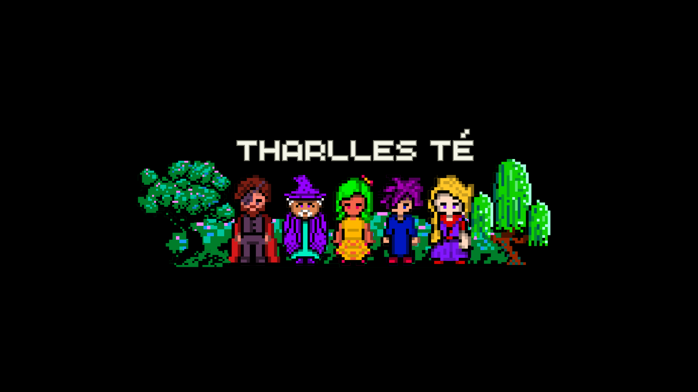

<!-- BANNER PERSONALIZADO -->
<p align="center">
  
</p>

<h1 align="center">Tharlles Jhoines Silva Té</h1>
<p align="center"><strong>Desenvolvedor Full Stack | Especialista em Backend | 37 anos</strong></p>

<p align="center">
  <a href="mailto:tharlles.engineer@gmail.com">✉️ Email</a> •
  <a href="https://www.linkedin.com/in/tharlles/">💼 LinkedIn</a> •
  <a href="https://wa.me/5577998152011" target="_blank">📱 WhatsApp</a>
</p>
---

### 👨‍💻 Sobre mim

Sou desenvolvedor full stack com mais de **7 anos de experiência**, apaixonado por **backend, arquitetura de sistemas, automação e performance**. Trabalho com tecnologias como Django, Angular, PostgreSQL, Docker e Kubernetes. Busco sempre criar soluções robustas, escaláveis e seguras.

### 🎓 Formação Acadêmica

- 📚 **Tecnólogo em Análise e Desenvolvimento de Sistemas** (em andamento)  
- 🛠️ **Técnico em Telecomunicações** — Concluído em 2015  

### 💡 Interesses e Especializações

- 🤖 **Automação e Robótica** — Foco em integração entre software e hardware, com aplicações industriais e residenciais.
- 📡 **Sinais de Radiofrequência (RF)** — Estudo e experimentação com recepção, modulação, decodificação e uso de RF para comunicação e sensoriamento.
- 🧠 **Sistemas Complexos e Desafiadores** — Interesse em arquiteturas de alta disponibilidade, tolerância a falhas e orquestração de serviços.
- 🌐 **Sistemas Distribuídos** — Desenvolvimento de aplicações resilientes e escaláveis com foco em mensageria, microserviços e computação paralela.

---

### 🛠️ Tecnologias e Ferramentas

<div align="center">
  
</div>

---

### 📈 Estatísticas GitHub

<p align="center">
  
  
</p>

---

### 📽️ Outros Projetos e Conteúdos

> Em breve: canal com tutoriais, cases reais e engenharia reversa de sistemas backend

---

### 💬 Fale comigo

```bash
Email: tharlles.engineer@gmail.com
Linkedin: https://www.linkedin.com/in/tharlleste/
Instagram: https://www.instagram.com/tharlles_te/
